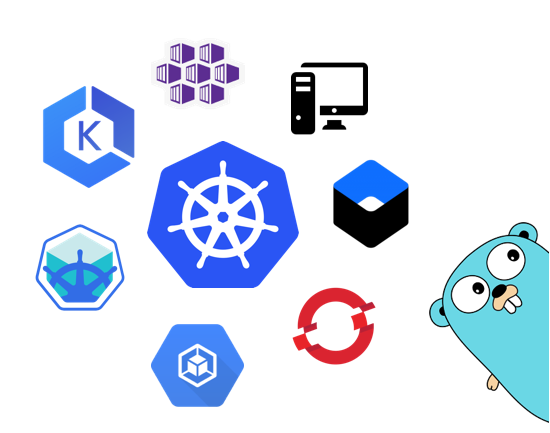

## K8s-Discovery
[](https://pkg.go.dev/github.com/gkarthiks/k8s-discovery)


[](https://goreportcard.com/report/github.com/gkarthiks/k8s-discovery)

[](https://bestpractices.coreinfrastructure.org/projects/5036)



*K8s Discovery*, is an effort to reduce the boiler plate code for the [client-go](https://github.com/kubernetes/client-go) or kubernetes based cloud native [GoLang](https://golang.org) developers.

The main aspect of this is around saving and cleaning the code for in-cluster and out-cluster configurations. 


## Requirements

- Go 1.26.0 or newer.
- Access to a Kubernetes cluster with permissions for the API calls your application makes.
- A metrics API provider, such as metrics-server, and permission to list pod metrics if using the metrics example below.

## Usage

Install the module in your Go project:

```sh
go get github.com/gkarthiks/k8s-discovery
```

Initialize the clients and handle configuration errors:

```go
k8s, err := discovery.NewK8s()
if err != nil {
	log.Fatalf("Initialize Kubernetes clients: %v", err)
}
```

`NewK8s()` tries in-cluster service-account configuration first. If that fails, it loads a local kubeconfig and uses its current context. Set `KUBECONFIG` to a single file to choose a specific configuration; otherwise the default is `$HOME/.kube/config`. When `KUBECONFIG` lists multiple paths, this library selects the first existing file rather than merging them.

Client construction does not verify connectivity or API permissions. Those failures are returned by subsequent API calls.

## Available APIs

- **NewK8s:** Returns the Kubernetes clientset, metrics clientset, and REST configuration, or an error if configuration or client construction fails.
- **GetVersion:** Queries the API server and returns its Kubernetes version, or a request error.
- **GetNamespace:** Returns the non-empty `POD_NAMESPACE` environment variable first, then the trimmed contents of `/var/run/secrets/kubernetes.io/serviceaccount/namespace`. If neither is available, it returns an empty string with no error. It does not use the namespace from kubeconfig.

Set `CLIENTSET_LOG` to enable configuration and version logging. The presence of the variable enables logging, even if its value is empty or `false`.

## Available clients

- `Clientset`: The standard Kubernetes client interface for working with resources such as Pods and CronJobs.
- `MetricsClientSet`: The metrics client for querying pod and node resource usage.
- `RestConfig`: The underlying `*rest.Config`, which can be used to create additional clients.

## Example

Save the following as `main.go` in a Go project with this module installed. The example lists CronJobs and pod metrics in one namespace. When running locally, set `POD_NAMESPACE` explicitly, for example:

```sh
POD_NAMESPACE=default go run .
```

Your credentials need permission to list CronJobs in the `batch` API group and pods in the `metrics.k8s.io` API group in the selected namespace. Metrics queries also require an available metrics API provider.

```go
package main

import (
	"context"
	"fmt"
	"log"
	"time"

	discovery "github.com/gkarthiks/k8s-discovery"
	metav1 "k8s.io/apimachinery/pkg/apis/meta/v1"
)

func main() {
	if err := run(); err != nil {
		log.Fatal(err)
	}
}

func run() error {
	k8s, err := discovery.NewK8s()
	if err != nil {
		return fmt.Errorf("initialize Kubernetes clients: %w", err)
	}
	namespace, err := k8s.GetNamespace()
	if err != nil {
		return fmt.Errorf("get namespace: %w", err)
	}
	if namespace == "" {
		return fmt.Errorf("namespace is empty; set POD_NAMESPACE when running locally")
	}
	version, err := k8s.GetVersion()
	if err != nil {
		return fmt.Errorf("get Kubernetes version: %w", err)
	}
	fmt.Printf("Namespace: %s\nKubernetes version: %s\n", namespace, version)

	ctx, cancel := context.WithTimeout(context.Background(), 30*time.Second)
	defer cancel()

	cronJobs, err := k8s.Clientset.BatchV1().CronJobs(namespace).List(ctx, metav1.ListOptions{})
	if err != nil {
		return fmt.Errorf("list CronJobs in %s: %w", namespace, err)
	}
	for _, cronJob := range cronJobs.Items {
		fmt.Printf("CronJob: %s\n", cronJob.Name)
	}

	podMetrics, err := k8s.MetricsClientSet.MetricsV1beta1().PodMetricses(namespace).List(ctx, metav1.ListOptions{})
	if err != nil {
		return fmt.Errorf("list pod metrics in %s: %w", namespace, err)
	}
	for _, pod := range podMetrics.Items {
		for _, container := range pod.Containers {
			fmt.Printf("Pod: %s, container: %s, CPU: %s, memory: %s\n",
				pod.Name, container.Name,
				container.Usage.Cpu().String(), container.Usage.Memory().String())
		}
	}
	return nil
}
```

The example prints Kubernetes quantities with their units, such as `100m` for CPU and `64Mi` for memory, without converting them to floating-point numbers. `MetricsV1beta1()` is the metrics API client; CronJobs use the stable `BatchV1()` API.

## Authentication

Inside a pod, the library uses the mounted service-account credentials. Grant the service account the permissions needed for your application's requests.

Outside a cluster, authentication comes from kubeconfig. For configurations using [client-go credential plugins](https://kubernetes.io/docs/reference/access-authn-authz/authentication/#client-go-credential-plugins), install the executable referenced by `users[].user.exec.command` and make it available to the application. A bare command name must be on `PATH`.

For GKE, install `gke-gcloud-auth-plugin` and refresh your kubeconfig using the [GKE cluster access instructions](https://cloud.google.com/kubernetes-engine/docs/how-to/cluster-access-for-kubectl). The old blank import of `k8s.io/client-go/plugin/pkg/client/auth` does not restore the removed built-in GCP auth provider.

## Contributing

For contributions please refer to the [contributing guidelines](CONTRIBUTING.md).
